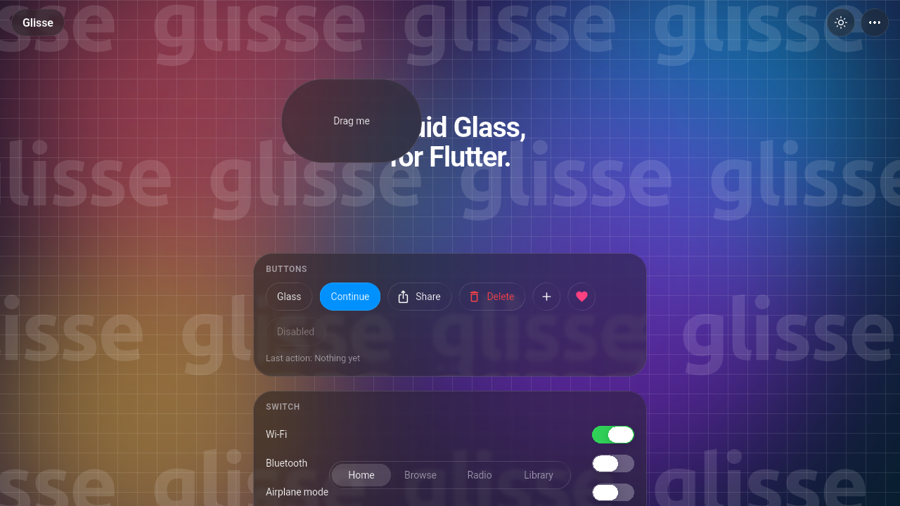

# Glisse for Flutter

Apple's **Liquid Glass**, for Flutter, on every platform: Android, iOS, web, macOS, Windows and Linux.

This is a port of [Glisse](https://glisse.kelvinzhang.ca) ([source](https://github.com/0kzh/glisse)), Kelvin Zhang's faithful web implementation of iOS 26's Liquid Glass. Glisse bends what's behind its glass with SVG displacement maps drawn on a canvas. Here the same maths runs in one fragment shader. It covers the bezel's Snell's-law refraction, the dome lens, the chromatic split, the frost, and the lit rim. The springs, press physics, sizes and colours are carried over from Glisse unchanged.

| Light | Dark |
| --- | --- |
|  |  |
|  |  |

## Widgets

**Ported from Glisse**, with the same measurements, springs and lenses:

| Widget | What it is |
| --- | --- |
| `Glass` | A pane of glass that bends its backdrop at the rim, frosts and tints it, and lights its edge. |
| `GlassButton` | The iOS 26 glass button. It swells and stretches under a finger and springs back past its size. Glass or filled, tinted, destructive, or icon-only. |
| `GlassSwitch` | A white knob that lifts into a lens while held, bending the track under its rim. It can be dragged across. |
| `GlassSlider` | A slider whose thumb lifts into a magnifying lens over a thicker stand-in track. |
| `GlassSegmentedControl` | A thumb on a glass track that lifts into a lens over the labels while held or dragged. |
| `GlassTabBar` | Tabs on glass, with or without icons. The selection springs between tabs, follows a drag, and lifts into a chromatic lens that smears labels at its rim. |
| `GlassMenu` | A glass button that morphs into a frosted menu, with drag-to-choose, a sliding highlight plate and rubber-band resistance. |
| `GlassInput`, `GlassSearchField` | Text fields on glass. The search field has a clear button. |

**New for Flutter**, built from the same glass:

| Group | Widgets |
| --- | --- |
| Overlays | `showGlassDialog` + `GlassAlertDialog`, `showGlassSheet` (a floating sheet you drag to dismiss), `showGlassToast`, `GlassPopover`, `GlassTooltip` |
| Controls | `GlassCheckbox`, `GlassRadio`, `GlassStepper`, `GlassChip`, `GlassProgressBar`, `GlassProgressRing`, `GlassActivityIndicator`, `GlassPageIndicator`, `GlassBadge`, `GlassButtonGroup` |
| Navigation | `GlassNavigationBar`, `GlassBackButton`, `GlassToolbar`, `GlassListSection` + `GlassListTile`, `GlassSidebar`, `GlassDock` (macOS-style magnifying dock) |
| Lenses | `GlassMagnifier` (a draggable magnifying lens), `GlassLoupeRegion` (a loupe on long-press) |
| Building blocks | `GlassBackdrop`, `GlassTheme`, `GlassPressable`, `GlassSpring`, `LiquidGlassBox` |

## Install

```yaml
dependencies:
  glisse:
    git: https://github.com/devilAPI/glisse-flutter
```

## Use

```dart
import 'package:glisse/glisse.dart';

GlassBackdrop(
  background: Image.asset('wallpaper.jpg', fit: BoxFit.cover),
  child: Center(
    child: Column(mainAxisSize: MainAxisSize.min, children: [
      GlassButton(
        variant: GlassButtonVariant.filled,
        onPressed: () {},
        child: const Text('Continue'),
      ),
      GlassSwitch(value: wifi, onChanged: (v) => setState(() => wifi = v)),
      GlassSlider(value: volume, onChanged: (v) => setState(() => volume = v)),
      GlassSegmentedControl<String>(
        segments: const [
          GlassSegment(value: 'day', label: 'Day'),
          GlassSegment(value: 'week', label: 'Week'),
        ],
        value: view,
        onChanged: (v) => setState(() => view = v),
      ),
    ]),
  ),
)
```

Overlays, controls and navigation work the same way:

```dart
// An alert
final allowed = await showGlassDialog<bool>(
  context: context,
  builder: (context) => GlassAlertDialog(
    title: const Text('Allow “Glisse” to use your location?'),
    content: const Text('Your location is used to show nearby glass.'),
    actions: [
      GlassDialogAction(result: false, child: const Text('Don’t Allow')),
      GlassDialogAction(result: true, isDefault: true, child: const Text('Allow')),
    ],
  ),
);

// A floating sheet you can drag away, and a toast
showGlassSheet(context: context, builder: (context) => const Text('Share'));
showGlassToast(context, message: const Text('Copied'), icon: const Icon(Icons.check_circle));

// A grouped list, a toolbar and a magnifier
GlassListSection(header: const Text('Network'), children: [
  GlassListTile(leading: const Icon(Icons.wifi), title: const Text('Wi-Fi'), showChevron: true, onTap: () {}),
]);
GlassToolbar(children: [
  GlassToolbarItem(icon: const Icon(Icons.undo), semanticLabel: 'Undo', onPressed: () {}),
  GlassToolbarItem(icon: const Icon(Icons.redo), semanticLabel: 'Redo', onPressed: () {}),
]);
const GlassMagnifier(size: 140, magnification: 1.8);
```

Glisse widgets follow the ambient brightness. To set the colours or the tuning yourself, use `GlassTheme`:

```dart
GlassTheme(
  data: GlassThemeData.light().copyWith(
    glassBend: 2.5,        // how far the rim reaches in
    glassDispersion: 1.2,  // how far the colours split
    blur: 4,               // the frost
    fill: Colors.indigo,   // the accent
  ),
  child: ...,
)
```

To load the shader before the first frame, call `await GlassShaders.precache();` in `main`. This is optional: glass loads the shader on its own and frosts until it's ready.

## How glass sees what's behind it

Glass can only bend what it can read, so it reads it in one of three ways (`GlassMode`):

- **captured**: inside a `GlassBackdrop`, glass bends a copy of the backdrop's `background`. The copy is taken again after every frame in which the background painted anything new, so the background may scroll and animate. This works on every renderer, including Skia, the web (CanvasKit and Skwasm), Linux and Windows. It mirrors Glisse's `data-glisse-backdrop`.
- **backdropFilter**: on Impeller (iOS, Android, macOS), glass bends the *live* backdrop behind it through `ImageFilter.shader`. No `GlassBackdrop` is needed.
- **frost**: everywhere else, glass blurs and saturates its backdrop under its tint and lit rim, as Glisse does in browsers that can't filter a backdrop.

`GlassMode.auto`, the default, picks the first of these that works. Set a mode per widget, or for a subtree with `GlassThemeData.mode`.

Controls that bend their *own* content need no backdrop at all: the switch's track, the slider's track, and the labels under a tab bar's lens. They record that content into an image and bend it, so they refract everywhere.

## Platform notes

- **Skia and the web** refract inside a `GlassBackdrop`, and frost outside one.
- **Impeller with OpenGL ES**: render targets are upside down there, and the shader corrects for it. One old Android device running Mesa's freedreno GLES driver drew no backdrop filters at all, Flutter's own blur included, while Skia on the same device rendered everything. If Impeller misbehaves on a device, try `--no-enable-impeller`.
- **Performance**: a `GlassBackdrop` copies its background only after frames in which it changed, at the display's pixel ratio (`pixelRatio` lowers it). Glass over a background that changes every frame copies it every frame.
- **Reduced motion**: when the platform asks for it (`MediaQuery.disableAnimations`), every spring lands at once.

## The gallery

`example/` is a gallery of every widget over an animated wallpaper. It includes a playground for the bend, dispersion, frost and rim light, and a switch between the glass modes.

```sh
cd example
flutter run -d chrome   # or linux, macos, windows, android, ios
```

## Tests

```sh
flutter test                       # behaviour and golden tests
flutter test --update-goldens      # re-render the goldens in test/goldens/
```

The goldens are rendered with real Roboto from the Flutter SDK, so they double as screenshots of each widget in both themes.

## Credits

Glisse, its measurements of iOS 26.1, and its design are by [Kelvin Zhang](https://kelvinzhang.ca), MIT licensed. Glisse in turn credits Aave's web glass and [kube.io's study of Liquid Glass refraction](https://kube.io/blog/liquid-glass-css-svg/). This port is MIT licensed too.
